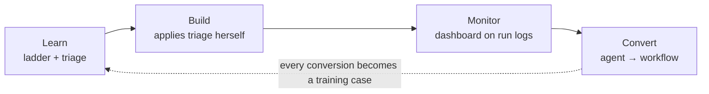
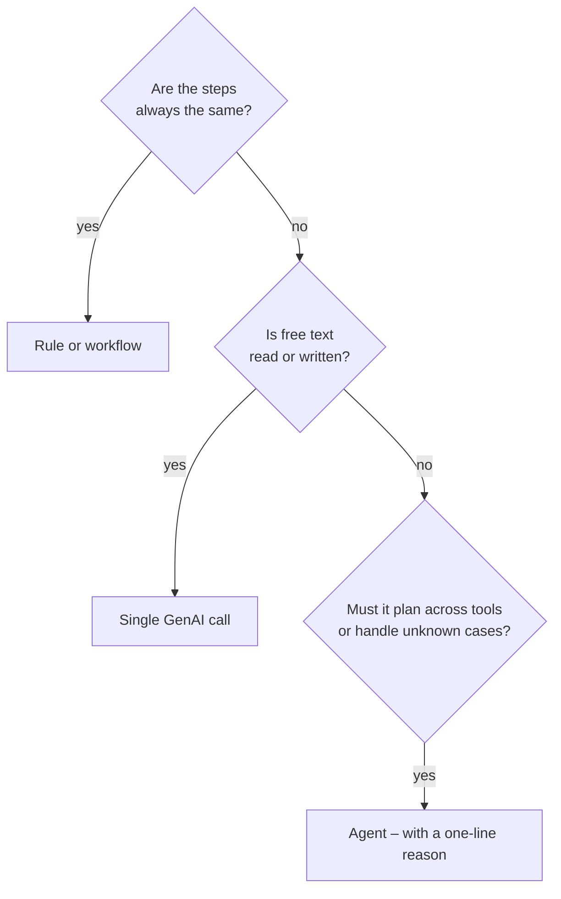

# 3 · Solution

rAIght supports the process owner through one loop. **She does every step herself.**

## 1 Learn – training

- Short module on the automation ladder, with recruiting examples
- The triage approach, taught so the process owner can apply it on her own
- Later: refresher built from real conversions in the company

## 2 Build – self-applied triage

The process owner answers three questions while creating an automation:

There is no approval gate. The dashboard is the check **after the fact**: a wrong choice shows up as a uniform agent.

## 3 Monitor – dashboard

Built on run logs that already exist. **No extra AI checks the AI** – only simple statistics.

| Column | Meaning |
|---|---|
| Tokens / month | Taken straight from the run logs |
| Same path | Share of runs with an identical sequence of steps |
| rAIght suggests | e.g. *Convert to workflow*, *Replace with rule*, *Use template*, *Keep for complex cases* |

Example (illustrative values):

| Agent | Same path | Suggestion |
|---|---|---|
| Application status | 94% | Convert to workflow |
| Document check | 91% | Replace with rule |
| Offer letters | 88% | Use template |
| Interview scheduling | 52% | Keep agent for complex panels |

Flags (example thresholds, to be validated):

- same-path share above threshold for 4 weeks → **flagged as uniform**
- no runs for 90 days → **flagged as unused**

## 4 Convert – guided conversion

- rAIght shows the agent's most frequent paths as a **draft workflow**, generated from log statistics
- The process owner accepts and adjusts it – **no developer needed**
- Standard cases go to the workflow; the agent keeps only the exceptions
- No exceptions left for 90 days → agent is retired
- Each closed conversion becomes a case in the training

## Use cases (illustrative, recruiting admin)

| Process | Today | Should be | Agent only for |
|---|---|---|---|
| Application status | Agent answers every "where is my application?" | Workflow: notifications at each stage | Unusual questions, complaints |
| Document check | Agent reads every application | Rule: form checks required fields | Unclear or foreign certificates |
| Interview scheduling | Agent emails, compares calendars, books rooms | Workflow: candidate picks a slot | Multi-round panels across time zones |
| Offer letters | Agent drafts each offer from scratch | Workflow: template from approved data; human signs | Non-standard packages |
