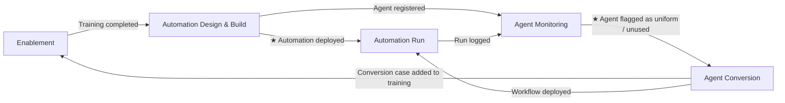

# 7 · EventStorming – Big Picture (corrected)

Top level, use-case neutral. **Corrected on 15 Oct 2026:** the process owner is the actor throughout – there is no AI engineer, and triage is part of her build process, not a separate approval step. The old board and deck (`docs/eventstorming-board/`, `docs/presentations/SAP_Right_AI_EventStorming.pptx`) still show the previous version.

Notation: **events** in past tense · ★ = **pivotal event** (handover to the next bounded context) · **H#** = hotspot.

## Bounded contexts

| Bounded context | Actor | Key events | Hotspots |
|---|---|---|---|
| **Enablement** | L&D (assigns), process owner | Process owner role assigned → Ladder & triage training assigned → **Training completed** | H1 |
| **Automation Design & Build** | Process owner | Automation need identified → **★ Triage applied** (ladder step chosen) → Agent reason recorded *(only if agent)* → Automation built → **★ Automation deployed** → Agent registered in inventory | H2, H3 |
| **Automation Run** | Requester; process owner for escalations | Request received → Request completed / **Request escalated to process owner** → **Run logged** | – |
| **Agent Monitoring** | Monitoring service | Run logs collected → Token usage calculated · Same-path share calculated → Dashboard updated → **★ Agent flagged as uniform** / Agent flagged as unused | H4, H5, H6 |
| **Agent Conversion** | Process owner | Flag reviewed → Draft workflow generated from frequent paths → Conversion accepted / rejected with reason → **★ Agent scope reduced to exceptions** → Agent retired → Conversion case added to training | H7 |

External systems: learning platform · low-code / agent platform · LLM / cloud provider · agent platform logs.

## Decision rules (former policies)

- New process owner → training is assigned automatically
- Steps always the same → rule or workflow; open-ended → GenAI call or agent (with a one-line reason)
- Every agent is registered for monitoring when deployed
- Unknown case or low confidence → escalate to a human
- Same-path share above threshold for 4 weeks → flag as uniform *(example value)*
- No runs for 90 days → flag as unused *(example value)*
- No exceptions left for 90 days → retire the agent *(example value)*
- Closed conversion → added to training as a case

## From contexts to services (first cut)

Lecture heuristic: one bounded context = one service; a team owns at most two contexts.

| Context | Publishes | Listens to |
|---|---|---|
| Enablement | Training completed | Process owner role assigned, Conversion case added |
| Automation Design & Build | Automation deployed, Agent registered | Training completed |
| Automation Run | Run logged, Request escalated | Automation deployed, Workflow deployed |
| Agent Monitoring | Agent flagged as uniform / unused | Run logged, Agent registered |
| Agent Conversion | Workflow deployed, Agent retired, Conversion case added | Agent flagged |
